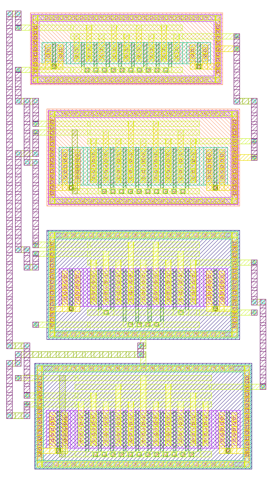

# Floorplanning and routing several blocks (`glayout.floorplan`)

`glayout.floorplan` takes a set of analog blocks (cells such as a current
mirror or a differential pair, each available in several shapes), places them
with a simulated annealer that respects symmetry, routes the nets between them
with a two-layer grid router, and returns one layout with a composed netlist,
so the result can be checked with DRC and LVS.

The worked example is a two-stage OTA built from finger-sequence cells
([`two_stage_ota.py`](two_stage_ota.py)). It routes and is DRC and LVS clean
on gf180 and sky130.



*The routed example on gf180 (closed loop, seed 0). From the top: CS and
LOAD (PMOS), DP and BIAS (NMOS). The router's wires run horizontally on met3
and vertically on met4, in the space reserved around the blocks.*

```
cells with shape variants ──build_block──> Block (Variant, Pin, Access)
                                               │
Circuit: instances, nets, symmetry, ports      │
                                               ▼
        ┌──> apply_drr: pad each block for routing
        │         │
        │         ▼
        │    anneal_floorplan: sequence pair + variants, symmetric
        │         │
        │         ▼
        │    route: two-layer grid router (met3/met4)
        │         │ failed?
        └─────────┘  grow padding near the failures (closed_loop_floorplan)
                  │ routed
                  ▼
        route_floorplan: place cells, draw wires and vias, labels, netlist
```

## Run the example

From the repository root:

```bash
PYTHONPATH=src python docs/floorplan/two_stage_ota.py --pdk gf180 --mode closed_loop
```

`--mode drr` uses fixed padding and routes afterwards; `--mode unrouted`
stops after placement. Each step prints a table of what it did; set
`GLAYOUT_TABLES=0` to silence them, or `GLAYOUT_TABLES_DEPTH=1` to keep only
the outermost ones.

## 1. Blocks and shape variants

A `Block` is one functional group with one or more `Variant`s: the same
circuit drawn in a different shape. In the example every device keeps its
total width W and only the split changes, for example 12 µm as 2 × 6, 4 × 3 or
8 × 1.5 fingers.

```python
from glayout.cells.elementary.finger_sequence import cc_diff_pair
from glayout.floorplan import build_block

dp = build_block(pdk, "DP", "DP", cc_diff_pair,
                 [dict(fingers=f, width=w, device="nfet") for f, w in [(2, 6.0), (4, 3.0), (8, 1.5)]])
```

`build_block` calls the builder once per variant and records each variant's
size and its pins. Which ports belong to which net comes from
`component.info["pins"]` (the finger-sequence cells set it) or from a
`net_ports` function. For every port the block keeps an `Access`: the side it
faces, its layer and width, and the cell's other shapes near the port that a
wire leaving through it must keep clear of.

## 2. The circuit

A `Circuit` lists the block instances and maps each block's pin nets to
circuit nets. It also holds the placement constraints and the nets that get
top-level pins.

```python
from glayout.floorplan import Circuit, Instance

circuit = Circuit(
    "two_stage_ota",
    [Instance("DP", blocks["DP"], {"VINP": "VINP", "VINN": "VINN", "VOUT1": "N1", "VOUT2": "N2",
                                   "VTAIL": "VTAIL", "B": "VSS"}),
     Instance("LOAD", blocks["LOAD"], {"VREF": "N1", "VOUT": "N2", "VSS": "VDD", "B": "VDD"}),
     ...],
    self_symmetric=["DP", "LOAD"],        # centred on one vertical axis
    ports=["VINP", "VINN", "VOUT", "IBIAS", "VDD", "VSS"],
)
```

`symmetric_pairs=[("A", "B")]` places two instances mirror-symmetric about the
same axis, with the second one drawn mirrored. `circuit.graph()` returns the
device/pin/net graph with feature vectors, for use by a learning model.

## 3. Padding for routing (DRR)

`apply_drr(pdk, blocks, scale=1.0)` reserves routing space around every
variant (dynamic routing resource):

    padding = ζ + scale · (pins leaving that way) · track

`track` is the router's pitch (via pad plus spacing on met3/met4).
ζ is half the largest spacing rule between two cells' outer layers, so padded
blocks that touch are always legal with each other. `scale=0` turns the
routing term off; `scales={block: s}` sets it per block.

## 4. Placement by annealing

`anneal_floorplan(circuit, weights, seed=0)` searches over sequence pairs
(the relative order of the blocks) and the variant of each block. Its cost is

    α · area / Σ block area  +  β · HPWL / HPWL_ref  +  γ · (aspect target − aspect)²  +  δ · symmetry residual

where HPWL uses the real pin positions of the chosen variants and HPWL_ref is
the best of 200 random placements. After packing, self-symmetric blocks and
symmetric pairs are slid onto the axis where that overlaps nothing; any
remaining offset is the symmetry residual. Moves swap two blocks in one or
both sequences, or change a block's variant (a symmetric partner follows).
The search is deterministic for a given `seed`.

`realize_floorplan(pdk, result)` places the cells without routing them.

## 5. Routing between blocks

`route(problem, RouterTech.from_pdk(pdk))` routes on a grid with one
horizontal layer (met3) and one vertical layer (met4), joined by vias.

1. **Grid.** The pitch is the larger via pad plus spacing of the two layers.
   Nodes too close to a cell are removed, so cells are obstacles.
2. **Pin access.** Each net picks the combination of block sides with the
   smallest half-perimeter wirelength (ties go to the less crowded channel).
   Each pin then gets a short stub on its own layer out to a landing point just
   outside its cell, with a via up to the routing layers.
3. **Search.** Multi-pin nets are connected in minimum-spanning-tree order
   with a bidirectional A\* (cost: distance, vias, and conflicts with other
   nets).
4. **Rip-up and reroute.** Nets that share a node are ripped up, the cost of
   the nodes they used goes up, and they are routed again, for up to 35
   rounds.
5. **Detours.** A net whose wire is more than twice the minimum spanning tree
   of its landings is tried again on other sides, and the change is kept only
   if wirelength plus via cost drops.

Routing is deterministic. The result lists failed nets, pins that found no
legal landing, wirelength, vias and the points where routing failed.

## 6. Closed loop: grow padding only where routing fails

`closed_loop_floorplan(pdk, circuit, blocks, tech, seed=0)` starts with no
routing padding (`start_scale=0`). Each round it pads, anneals and routes. If
routing fails, it raises the padding scale by `step` (0.25) on the blocks
nearest to the failures, and only on those. It stops when the floorplan
routes. On the example it needs three rounds on gf180 and four on sky130.
With `in_loop=True` the router also runs inside the annealer on every new
best placement.

## 7. Routed layout, DRC and LVS

`route_floorplan(pdk, circuit, floorplan, tech)` places the cells, routes,
and draws the stubs, wires and vias. On gf180 it also adds top-level pin
labels, which the klayout LVS deck needs. The flat result carries the
composed netlist in `info["netlist"]`. The DRC/LVS runner builds the example
from this directory:

```bash
python tests/drc/run_cell_drc.py --pdk gf180 --params tests/parameters/routed_gf180.csv --engine both --out-dir drc_routed
python tests/lvs/run_cell_lvs.py --pdk gf180 --inputs-dir drc_routed --out-dir lvs_routed
```

The routed example (seed 0):

| PDK    | flow        | size (µm)     | wirelength (µm) | vias | klayout DRC | magic DRC | LVS   |
|--------|-------------|---------------|-----------------|------|-------------|-----------|-------|
| gf180  | fixed DRR   | 23.70 × 44.20 | 211.2           | 51   | clean       | clean     | match |
| gf180  | closed loop | 23.70 × 41.95 | 199.3           | 45   | clean       | clean     | match |
| sky130 | fixed DRR   | 30.00 × 46.66 | 318.9           | 44   | clean       | clean     | match |
| sky130 | closed loop | 30.00 × 45.23 | 317.6           | 43   | clean       | clean     | match |

Wirelength includes the pin stubs; each landing counts as one via.

## Limits

- Two routing layers only, and no routing over cells. A pin with no free
  landing spot outside its cell is reported as unreachable rather than routed
  through the cell.
- Symmetry is enforced by a greedy slide after packing. When it cannot be
  met, the residual is reported and penalised, not forbidden.
- Every pin lands with its own stub and via, so dense blocks need wider
  padding. The closed loop finds how much, block by block.
